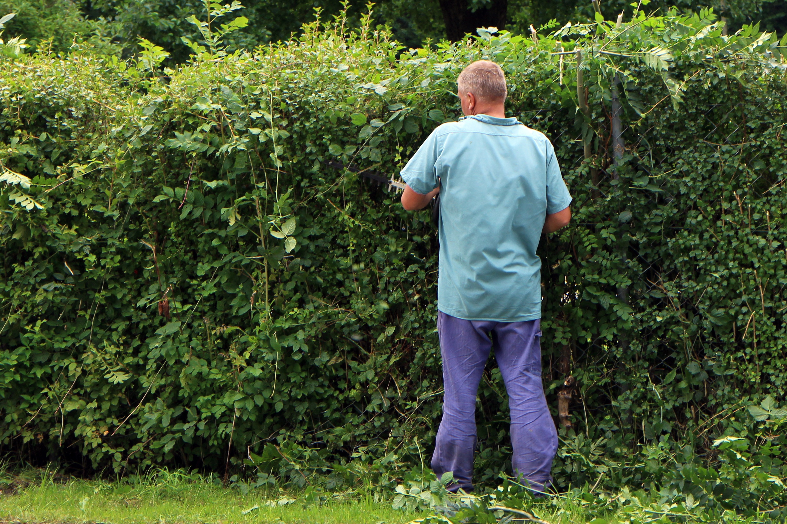
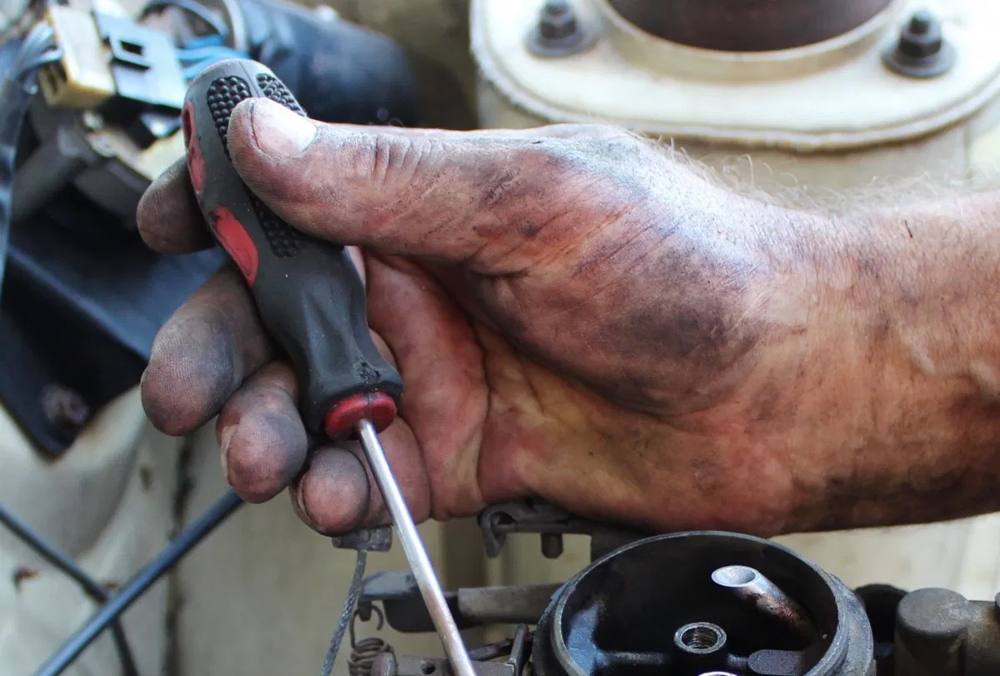

The design and development of MovingTrees is supported by four Personas, each representing a main actor of the system: a primary Persona, Paulo, a municipal gardener (Box 1); two secondary Personas on the operator side, André, a fleet operator (Box 2), and Pedro, a field technician (Box 3); and a secondary Persona responsible for the overall administration of the platform, Francisca, a municipal system administrator (Box 4).

Paulo is the primary Persona because the core value of the service, finding and using a suitable vehicle for green-space maintenance, is delivered to him. Pedro was kept as a distinct Persona from André, although both belong to the operator role, because he works in the field from a phone and has different needs from André, who manages the fleet from a desk. Francisca represents a different perspective: rather than focusing on individual fleet operations, she oversees the platform as a whole, ensuring that its operation, usage and performance can be monitored and managed effectively.

**Box 1.** Primary Persona: Paulo, a Field Worker.

<table>
<tr>
<td width="250" valign="top">

</td>
<td valign="top">

**Paulo** is a 42-year-old gardener who has worked in the Parks and Gardens department of the municipality for 15 years. Outside work, he enjoys fishing on weekends and watching football with his friends.

His team maintains six parks spread across the city, and every day he moves between two or three of them, carrying tools such as hedge trimmers, rakes and bags of fertilizer. Until now, he has depended on the department van, which is often busy, so he loses time waiting for it or walking between parks.

He uses his smartphone daily, but he is not a tech enthusiast: he gives up on apps that are slow or confusing. In the past, he was blamed for damage to equipment that was already broken when he picked it up, so he wants to know the condition of a vehicle before he uses it.

**Motivation:** Paulo would like to move between parks quickly with all his equipment, without depending on the department van, and be sure that the vehicle he picks up has enough battery and capacity for his route.

</td>
</tr>
</table>

**Box 2.** Secondary Persona: André, a Fleet Operator.

<table>
<tr>
<td width="250" valign="top">

</td>
<td valign="top">

**André** is a 31-year-old operations coordinator at MovingTrees, responsible for the contract with the municipality. He has a degree in logistics management and, in his free time, he plays padel with his colleagues and likes to cycle along the river on Sundays.

He manages the fleet day to day and is the person responsible for the maintenance tasks on the platform: he creates repair tasks when a vehicle has a problem, decides how urgent each one is, assigns it to a field technician and follows it until it is closed. He also registers new vehicles and makes sure each hub has enough of them. He works mostly at a desk, and needs a clear view of the whole fleet and of all open tasks at once.

His work is evaluated by how quickly broken vehicles are fixed and how many vehicles are ready to use every day. Today he often finds out about problems only when a worker calls to complain, and he keeps track of repairs in spreadsheets and phone calls, so it is hard to know which tasks are late or who is working on each one.

**Motivation:** André would like to create and track all maintenance tasks in one place, assign them to the right technician, and be warned about faults and late repairs before workers are affected.

</td>
</tr>
</table>

**Box 3.** Secondary Persona: Pedro, a Field Technician.

<table>
<tr>
<td width="250" valign="top">

</td>
<td valign="top">

**Pedro** is a 26-year-old maintenance technician at MovingTrees. He finished a vocational course in electromechanics and has always liked fixing bicycles. In his free time, he goes mountain biking with friends.

He spends the day on the street, going from hub to hub to inspect vehicles, swap batteries and do repairs. He uses the platform only on his phone, often with dirty hands or gloves, so he needs screens with few steps and big buttons.

Today he receives tasks by phone call or text message, often without details about the fault. Sometimes he travels to a hub and finds that the vehicle has already been moved, or that he did not bring the right part.

**Motivation:** Pedro would like to know which repairs are his and which are most urgent, get clear information about each fault before he leaves, and register what he did quickly so the vehicle can be used again.

</td>
</tr>
</table>

**Box 4.** Secondary Persona: Francisca, a Municipal System Administrator.

<table>
<tr>
<td width="250" valign="top">

</td>
<td valign="top">

**Francisca** is a 49-year-old systems administrator responsible for managing the MovingTrees service within her municipality. She has a degree in Information Systems and, outside work, enjoys hiking and exploring new technologies.

She oversees how MovingTrees is configured and used by her municipality, ensuring that the platform reflects its specific needs. She manages local user accounts and permissions, defines usage policies, configures fleet restrictions and hub capacities, and monitors the municipality's fleet activity. She also follows operational indicators such as vehicle utilization, availability, maintenance times and service compliance, allowing her to assess whether the service meets the municipality's requirements.

As the municipality's needs evolve, keeping the platform aligned with its operations becomes increasingly challenging. Different teams may require different vehicle types, usage limits or access permissions, while the municipality must also justify the service's cost and effectiveness. She needs a centralized view of local activity and performance, with the ability to adjust configurations and identify operational issues.

**Motivation:** Francisca wants to manage MovingTrees according to her municipality's specific needs, maintaining control over users, fleet usage policies and hub configurations, while having reliable information about service utilization and performance to support decisions and demonstrate its value.

</td>
</tr>
</table>
